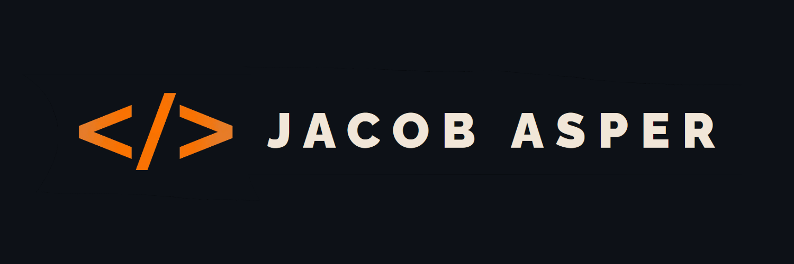

<!DOCTYPE html>
  
 
 

Check out my blog for some good stuff. <a href="https://jacobasper.com">jacobasper.com</a> 
 
Rust is a must 🦀🦀🦀🦀
 
Professional typo fixer
 
I'm currently working on JJPWRGEM
 
 <h2 align="center">Connect with me</h2> 
  
